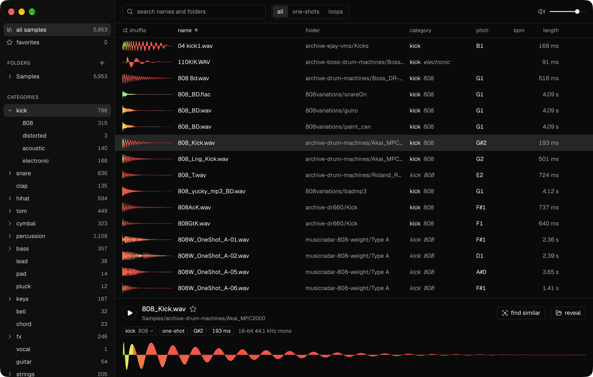

# Samplary

A fast, simple sample manager. Point it at your sample folders and browse
them by folder, category, one-shot or loop, with colored waveforms, search
as you type, favorites, and the pitch, key and tempo of every sample. Drag
any of them straight into your DAW.



## What it does

- **Browse** folders, categories, one-shots or loops, and favorites, with
  colored waveforms (red lows, green mids, blue highs).
- **Search** names and folders as you type.
- **Play** a sample by selecting it, click the waveform to seek, and drag it
  into your DAW or Finder.
- **Shuffle** (`R`) any list into a new order, for when you don't know what
  you're after yet.
- **Categories** come from names first ("Kick", "BD", "Hi Hat", "Pad"). A
  sample whose name says nothing takes the category its nearest named
  neighbours agree on by sound, shown in italics. Drums, bass, keys, effects
  and strings split further, into 808, acoustic or electronic kicks, closed or
  open hats, shakers or congas and so on, found the same way. When a name
  gets it wrong, choose what the sample is from its category in the bottom
  panel. That teaches the guesses too.
- **Pitch, key and tempo** come from the audio, or from the name when it
  says ("Bass C#2", "120bpm", "Am").
- **Find similar** (`S`) ranks the library by how close each sample sounds.
  Four sliders weigh what counts: spectrum, timbre, pitch and amplitude.
  Dropping an audio file onto the window does the same for a sound that isn't
  in the library.
- **Keeps up** with your folders as files come, change and go, and keeps the
  library on disk between runs. A folder on an unplugged drive keeps its
  samples and favorites until it's back.
- **Stays fast** with over a hundred thousand samples.

Inspired by [Sononym](https://www.sononym.net).

Keys: `↑` `↓` move, `space` play or stop, `S` find similar, `F` favorite,
`R` shuffle, `⌘F` or `/` search, `esc` back.

It reads WAV, AIFF, FLAC, MP3, Ogg Vorbis, M4A (AAC and ALAC) and CAF.

## How it listens

The analysis is in plain Rust (`engine/`):

- **Spectrum**: mel band energies, centroid, flatness and rolloff over time.
- **Timbre**: MFCCs at the attack and through the body of the sound.
- **Pitch**: YIN for the fundamental and how it moves, plus chroma for the
  notes present.
- **Amplitude**: the envelope on a log time scale, onset rate and length.

Each aspect is standardized across the library and compared separately, so
the sliders can mix them. Tempo comes from onset autocorrelation, preferring
tempos that fit the loop into whole bars. Key comes from Krumhansl
profiles.

Then, in the background, it listens to each sample with
[CLAP](https://huggingface.co/laion/clap-htsat-unfused) (LAION's
contrastive language-audio model, Apache-2.0), run on the CPU with
[tract](https://github.com/sonos/tract). CLAP tells what a sound is
better than the analysis, and guesses weigh both.

`pnpm eval <folder>` reports how well the categories, pitches, tempos and
keys it finds agree with the names in a folder of labeled samples.

On a corpus of 5,700 named samples, a sample's category is guessed right 77%
of the time from its neighbours by sound, and wrongly 13% (it leaves the rest
unguessed), against 67% and 18% from the analysis alone.

## Building

Needs Rust, Node 24, [pnpm](https://pnpm.io) and Xcode 26 or later.
The first build downloads CLAP's model (118 MB) into `models/`.

```sh
pnpm install
pnpm make           # Samplary.app, zipped, in out/make
```

Publishing a release on GitHub builds it there, signed and notarized, and
attaches the zip to the release. Installed copies find it there and update
themselves.

## Developing

```sh
pnpm start          # the app, with hot reload
pnpm test           # engine tests
pnpm typecheck && pnpm lint
```

`engine/` is the engine, in Rust, a process of its own: the SQLite library,
scanning and watching folders, listening to files, searching and finding
similar sounds. `main/` is the Electron main process, written with
[Effect](https://effect.website): the window, and the calls between it and the
engine. `renderer/` is the React interface, and `shared/contract.ts` the
calls.
